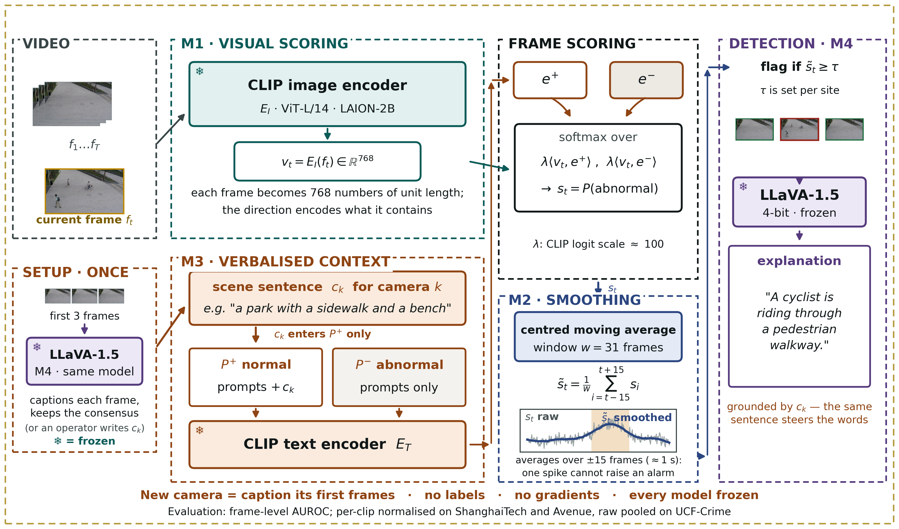
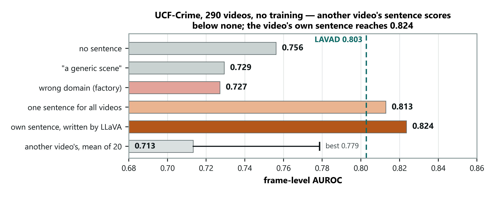

# DA-ZVAD: Domain-Adaptive Zero-Shot Video Anomaly Detection

> **M.Tech research project, NIT Calicut.** A training-free video anomaly
> detector built from frozen vision-language models, where moving to a new
> camera means giving it **one sentence describing the scene**: no new data,
> no labels, no retraining.

[](https://python.org)
[](https://pytorch.org)
[](LICENSE)

**Status (October 2026):** Phase 3 complete. Evaluated on MVTec AD,
ShanghaiTech, CUHK Avenue and UCF-Crime; XD-Violence and NWPU Campus are next.

---

## The problem

Most video anomaly detectors learn what "normal" looks like from hours of
footage from **one** camera. Move them to another camera and they fail, so every
new site needs new data and a new training run.

Domain adaptation is the usual fix, but it targets **covariate shift**: the
same things looking different (new lighting, new camera). Anomaly detection
mostly faces **concept shift**: the same thing *meaning* something different.
A vehicle is normal on a road and an anomaly on a walkway. The pixels can be
identical; only the place decides.

## The idea

If normality depends on the place, **tell the model what the place is.**
DA-ZVAD keeps every model frozen and carries all adaptation in a single
sentence per camera, which the system writes itself by captioning the camera's
first few frames.

Because nothing is trained, any change in the result comes from the sentence
alone. A deliberately **wrong** sentence then works as a falsifying control: if
a wrong description costs nothing, the method isn't really using its text.



| Module | What it does | Model |
|---|---|---|
| **M1** Visual scoring | Scores each frame against "normal" and "abnormal" text prompts | CLIP ViT-L/14 (LAION-2B), frozen |
| **M2** Temporal smoothing | Moving average over a window of frames, which removes one-frame spikes | none |
| **M3** Scene context | Adds the camera's sentence to the **normal** prompts only | none |
| **M4** Reasoning | Writes each camera's sentence at setup; can explain flagged events | LLaVA-1.5-7B, 4-bit, frozen |

## Results

Frame-level AUROC, with no training on any dataset.

| Dataset | Scenes | Result | For reference |
|---|---|---|---|
| **UCF-Crime** (290 test videos) | ~290 | **0.824** with per-video sentences by LLaVA | LAVAD 80.3, AnyAnomaly 80.7 (both training-free) |
| **ShanghaiTech** (107 clips) | 12 | **0.751** with per-camera sentences by LLaVA | 0.707 with no sentence, 0.734 with one shared sentence |
| **CUHK Avenue** (21 clips) | 1 | 0.706 with no sentence | Same as ShanghaiTech with no sentence (0.707), so detection transfers; with one camera a sentence doesn't help (0.677) |
| **MVTec AD** (images, baseline only) | n/a | 88.5% image AUROC | One-Class SVM *trained* on the same features: 92.4% |



### What we found

1. **Where the sentence goes matters more than what it says.** Added to the
   normal prompts only, a wrong sentence costs 0.105 AUROC on ShanghaiTech.
   Added to both prompt sets, the effect reverses (−0.029): shared text pulls
   the two prompt prototypes together (measured: the angle between them shrinks
   from 35.7° to about 25°).
2. **The system can write its own sentences.** LLaVA's captions (0.751) match
   hand-written ones (0.749). Both beat every one of the 11 ways of giving each
   camera another camera's sentence.
3. **It needs several scenes.** The effect is absent on single-camera Avenue
   (+0.020) and small inside any one ShanghaiTech camera (+0.033, 95% CI
   −0.005 to +0.070).
4. **Tested under predictions registered in advance.** The UCF-Crime protocol
   and four predictions were committed before any score was computed
   ([PREREG_ucf_crime.md](docs/10_phase3/PREREG_ucf_crime.md)). Three held.
   One, that the effect would grow with more scenes, was refuted, and the
   claim was narrowed accordingly.
5. **How it helps is being checked.** Judged only by how frames rank *within*
   each video, the sentence changes little (+0.006). Most of the gain comes from
   putting different cameras on the same score scale. A full check across all
   datasets is the next experiment.

## Repository layout

```
multimodal-anomaly-detection/
├── da_zvad/                  The pipeline package
│   ├── encoders/             M1: frozen CLIP encoder
│   ├── temporal/             M2: temporal smoothing
│   ├── context/              M3: scene sentence → prompts
│   ├── reasoning/            M4: LLaVA captioning and explanations
│   ├── prompts/              Normal / abnormal prompt ensembles
│   ├── datasets/             MVTec, ShanghaiTech, Avenue, UCF-Crime loaders
│   ├── evaluation/           AUROC / AP / F1
│   └── demo.py               CPU smoke test (no data, no GPU)
├── notebooks/                Experiment drivers run on the GPU server
├── scripts/                  Analyses, figures, slide and report builders
├── results/runs/             Run tables with a MANIFEST per run (commit, GPU, versions)
├── data_manifests/           UCF-Crime test-split member list
├── docs/                     Plan, literature, paper, slides, handbook (see docs/README.md)
├── src/                      Semester 2 MVTec CLIP baseline (kept for reference)
└── figure_assets/            Sample frames used in figures
```

## Running it

**Smoke test** (any machine, about a minute, no data needed):

```bash
pip install -r requirements.txt
python -m da_zvad.demo
```

**Real experiments** need a GPU. The results above were produced on an NVIDIA
A40 with Python 3.10 and PyTorch 2.3.1 / CUDA 12.1. On the server, install the
CUDA build of torch first, then the server requirements. These add LLaVA's 4-bit
stack, pinned to the versions that work together, and the UCF-Crime downloader:

```bash
pip install torch==2.3.1 --index-url https://download.pytorch.org/whl/cu121
pip install -r requirements-server.txt
```

The expensive step, encoding frames with CLIP, is done once and cached, so
every scoring variant afterwards runs in seconds.

```bash
# ShanghaiTech: cache embeddings, then per-camera sentences written by LLaVA
python notebooks/cache_embeddings.py --shanghaitech ~/dazvad/data/shanghaitech --crops 5
python notebooks/per_view_descriptors.py caption --label-free
python notebooks/per_view_descriptors.py run --desc notebooks/view_descriptors_llava_labelfree.json

# Context sweep (none / generic / matched / mismatched) and the within-camera control
python notebooks/run_experiments_server.py --shanghaitech ~/dazvad/data/shanghaitech \
       --runs ~/dazvad/runs --work ~/dazvad/work
python notebooks/within_view_control.py --raw ~/dazvad/work/raw --window 31

# UCF-Crime: fetch only the 290 test videos (~8 GB of the 103 GB archive), then score
python notebooks/fetch_ucf_crime_test.py
python notebooks/cache_embeddings.py --dataset ucf_crime --root ~/dazvad/data/ucf_crime \
       --frame-step 16 --crops 1
python notebooks/ucf_crime_sweep.py caption
python notebooks/ucf_crime_sweep.py run

# XD-Violence (pre-registered in docs/10_phase3/PREREG_xd_violence.md): 800 test videos, 10.8 GB
python notebooks/fetch_xd_violence_test.py
python notebooks/cache_embeddings.py --dataset xd_violence --root ~/dazvad/data/xd_violence \
       --frame-step 16 --crops 1
python notebooks/xd_violence_sweep.py caption
python notebooks/xd_violence_sweep.py run

# Measurement audit: does the sentence re-rank frames or calibrate videos? (CPU only)
python notebooks/measurement_audit.py --selftest
python notebooks/measurement_audit.py
```

Datasets are not included. Obtain them from their official sources:
[MVTec AD](https://www.mvtec.com/company/research/datasets/mvtec-ad),
[ShanghaiTech](https://svip-lab.github.io/dataset/campus_dataset.html),
[CUHK Avenue](https://www.cse.cuhk.edu.hk/leojia/projects/detectabnormal/dataset.html),
[UCF-Crime](https://www.crcv.ucf.edu/projects/real-world/).

## Documents

| Document | Where |
|---|---|
| Project report (IEEE format) | [docs/09_paper/report_ieee.tex](docs/09_paper/report_ieee.tex) |
| Full paper draft (living document) | [docs/09_paper/main.tex](docs/09_paper/main.tex) |
| Plain-language handbook: every result explained | [docs/08_understanding/00_HANDBOOK.md](docs/08_understanding/00_HANDBOOK.md) |
| UCF-Crime pre-registration | [docs/10_phase3/PREREG_ucf_crime.md](docs/10_phase3/PREREG_ucf_crime.md) |
| Slides and presentation scripts | [docs/06_presentations/](docs/06_presentations/) |
| Where every quoted figure from another paper comes from | [docs/07_reference_papers/PROVENANCE.md](docs/07_reference_papers/PROVENANCE.md) |

## Progress

| Phase | Work | Status |
|---|---|---|
| 1 | Literature study (six domain-adaptation surveys); concept-shift framing; frozen framework built | Done |
| 2 | ShanghaiTech and Avenue; context sweep; prompt-injection finding; within-camera control | Done |
| 3 | Per-camera sentences written by LLaVA; UCF-Crime under pre-registered predictions; citation check | Done |
| Next | Check of how the sentence helps; XD-Violence; NWPU Campus; patch-level scoring; M4 explanations | In progress |

## Key references

1. Radford et al., *Learning Transferable Visual Models From Natural Language Supervision* (CLIP), ICML 2021
2. Liu et al., *Visual Instruction Tuning* (LLaVA), NeurIPS 2023
3. Zanella et al., *Harnessing Large Language Models for Training-free Video Anomaly Detection* (LAVAD), CVPR 2024
4. Liu et al., *Future Frame Prediction for Anomaly Detection — A New Baseline* (ShanghaiTech), CVPR 2018
5. Sultani et al., *Real-World Anomaly Detection in Surveillance Videos* (UCF-Crime), CVPR 2018
6. Liu et al., *Deep Unsupervised Domain Adaptation: A Review of Recent Advances and Perspectives*, APSIPA Trans. 2022

The full bibliography is in [docs/09_paper/references.bib](docs/09_paper/references.bib).

## Author and supervisors

Prakash Kumar Sarangi, M.Tech (CSE), National Institute of Technology Calicut.
Supervised by Pranesh Das and Raju Hazari, Department of Computer Science and
Engineering, NIT Calicut.

## License

MIT; see [LICENSE](LICENSE).
