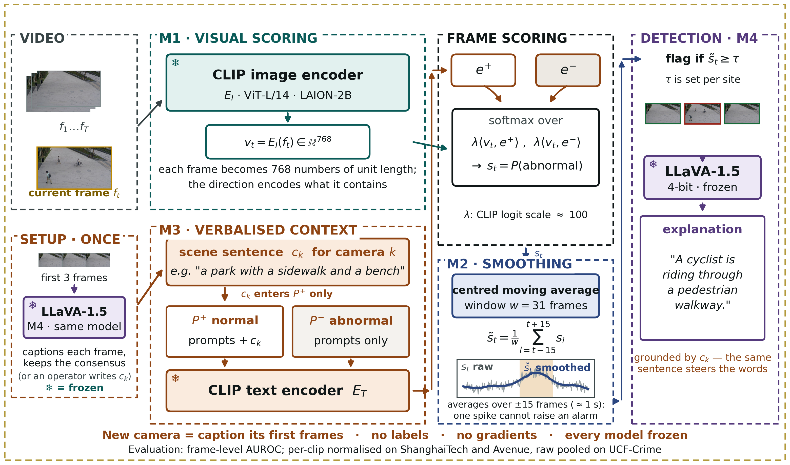
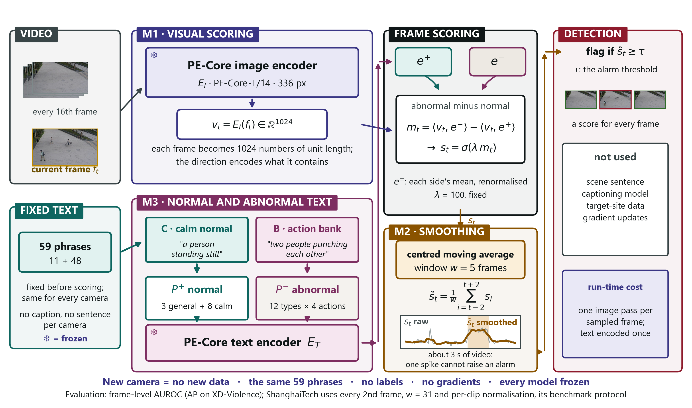

# DA-ZVAD — Presentation Script (about 27 minutes)

*Deck: DA-ZVAD_Final_Review.pptx · November 2026. "Page" means the small number
printed in the bottom-right corner of each slide.*

---

## Part A — Learn the story first

Before you learn any slide, learn this story. If you can tell it, you can give
the whole talk, and you can teach it to anyone: a friend, a parent, a first-year
student.

### The whole talk in five sentences

1. **The problem:** a camera that watches for unusual events has to be trained
   for its own place, because what is "normal" changes from place to place.
2. **Idea 1:** instead of training, I *tell* a frozen AI model in one sentence
   where the camera is, for example "a paved walkway with a bench".
3. **What I found:** the sentence helps, but mostly by putting different cameras
   on the same scale, and it **broke** on violent videos, because the sentence
   was written from frames that already showed the violence.
4. **Idea 2:** so I stopped describing each camera. I wrote **one fixed list for
   every camera**: what calm, quiet scenes look like, and 48 concrete bad
   actions, like "two people punching each other".
5. **The proof:** I froze everything, then tested once on a dataset I had never
   touched, UBnormal, like a **sealed exam paper**. It scored **0.747**, and all
   three predictions I wrote down beforehand came true.

### Six pictures to keep in your head

These are the memory hooks. Each one explains a hard idea in plain words.

| Hard idea | The picture to remember |
|---|---|
| Concept shift | **The forklift.** In a mall it is an alarm; in a factory it is routine. Same picture, different rule. |
| Frozen model | **A sealed calculator.** Nothing inside changes, so if the answer changes, only the input (the sentence) could have caused it. |
| Calibration | **Marks from different schools.** One school grades strictly, one generously. You must put them on one scale before ranking students. |
| Prototype dilution | **Two piles of words.** If you throw the same words into both piles, the piles start to look alike, and the model can no longer tell them apart. |
| Calm normal phrases | **Describing a quiet library.** "An empty room", "a person sitting quietly". Anything busy or violent then stands out. |
| Sealed test | **A sealed exam paper.** You study, you lock your answers, and only then do you open the paper. One attempt, no retakes. |

### The eight numbers worth remembering

| Number | What it means |
|---|---|
| **0.5** | Guessing. Every score is compared with this. |
| **0.707** | My detector on ShanghaiTech with no sentence. The starting point. |
| **0.105** | How much a *wrong* sentence costs. Proof the sentence matters. |
| **0.824** | UCF-Crime with a sentence per video (written by the model itself). |
| **82–87%** | How much of the sentence's help is just "putting cameras on one scale". |
| **0.624 → 0.417** | XD-Violence: the sentence made it worse. This is the failure. |
| **0.722** | XD-Violence after the fix (calm phrases and the action list). |
| **0.747** | The sealed test on unseen UBnormal. The final answer. |

### Words you will use, in plain English

- **AUROC:** pick one unusual frame and one normal frame at random. How often
  does the unusual one get the higher score? 0.5 = guessing, 1.0 = perfect.
- **AP (average precision):** XD-Violence's official score. Like AUROC, higher
  is better, but it cares more about getting the rare violent frames right.
- **Frozen:** the model is used exactly as downloaded. No training, no
  adjusting.
- **CLIP / PE-Core:** AI models that turn a picture and a sentence into lists of
  numbers, so we can measure how well the picture matches the sentence. PE-Core
  is the newer, stronger one.
- **LLaVA:** an AI model that looks at a picture and writes a sentence about it.
- **Prompt:** a short sentence we give the model, like "a calm and safe public
  area".
- **95% interval (confidence interval):** the range the true value very likely
  lies in. If the whole range is above zero, the gain is real, not luck.
- **Pre-registered:** I wrote my predictions and rules in git *before* running
  the test, so the date proves I did not change them afterwards.
- **Re-ranking vs calibration:** re-ranking = putting the right frames on top
  *inside* one video. Calibration = moving a whole video's scores up or down.

---

## Part B — How to use the slide script

Each slide below has:

- **Remember:** one line. If you forget everything else, say this.
- **Say:** the words, in the shaded box. Learn the **bold line** by heart; say
  the rest in your own words.
- **Point at:** where your hand goes, when it matters.
- **If they ask:** likely questions, with short answers.
- **→ Next:** one sentence that takes you to the next slide.

Three rules:

1. **Say numbers exactly as they appear on the slide.** 0.734 is "zero point
   seven three four", not "about 0.73".
2. **Say a weakness before they ask.** It sounds confident, not defensive.
3. **If you do not know:** *"I haven't measured that. The experiment that would
   answer it is…"* Never guess a number.

### The clock

| Pages | Part | Time | Clock at end |
|---|---|---|---|
| Title – 4 | The problem and the gap | 2 min 45 s | 2:45 |
| 5 – 9 | Phase 3 method and setup | 3 min 15 s | 6:00 |
| 10 – 17 | First failure, the fix, the main result | 3 min 50 s | 9:50 |
| 18 – 25 | Limits of the sentence, UCF-Crime | 3 min 25 s | 13:15 |
| 26 – 30 | Phase 3 assessment and summary | 2 min 5 s | 15:20 |
| 31 – 35 | Phase 4: what broke, how I worked | 2 min 40 s | 18:00 |
| 36 – 45 | Phase 4: the three ingredients and results | 5 min 25 s | 23:25 |
| 46 – 51 | The sealed test and the summary | 3 min 25 s | 26:50 |

**If you have only 15 minutes,** skip pages 8, 9, 12, 15, 16, 19, 22, 25, 26,
29, 41, 44, 45 and 48, and say only the **bold line** on pages 18, 27 and 42.

---

## Part C — Slide by slide

## Title · 20 s · *clock 0:20*

**Remember:** one detector for any camera, with no training.

> **Say:** "Good morning. My project is about detecting unusual events in video,
> such as fights, accidents or falls, **on any camera, without training
> anything.** I will show two phases: first, telling the model in one sentence
> where the camera is; then, when that broke, one fixed list of phrases for
> every camera, tested once on data I had never seen."

**→ Next:** "First, what anomaly detection is."

## Page 1 — What is video anomaly detection? · 30 s · *clock 0:50*

**Remember:** find the moment that doesn't belong.

> **Say:** "**Video anomaly detection means finding moments that do not fit what
> usually happens at that place.** A busy crossing is normal; a collision on it
> is an anomaly. The detector gives every frame a score, and the score rises at
> the unusual moment. It is hard because anomalies are rare and varied, so
> nobody can collect examples of all of them. Systems learn 'normal' instead."

**Point at:** the busy crossing → the collision → the rising score.

**If they ask:**
- *"Are these photos from your data?"* — No, they are public photos used to
  explain the idea. My data starts on page 9.

**→ Next:** "The catch is that 'normal' belongs to one place."

## Page 2 — A detector is tied to the place it learned · 40 s · *clock 1:30*

**Remember:** the forklift. Same picture, different rule.

> **Say:** "Today a detector watches weeks of footage from one camera to learn
> what normal looks like there. Move it to a new place and it fails, so you
> collect new footage and train again. Look at the forklift: in a mall it is an
> alarm, in a factory it is routine. **The picture did not change. The rule
> did.**"

**→ Next:** "This kind of change has a name in the research literature."

## Page 3 — The literature solves the neighbouring problem · 40 s · *clock 2:10*

**Remember:** research fixes changes in *appearance*; our problem is a change in the *rule*.

> **Say:** "The field of domain adaptation studies how data changes between
> places. It separates two kinds. **Covariate shift** is a change in
> appearance: a stop sign in fog is still a stop sign. **Concept shift** is a
> change in the rule: a bicycle on a road is fine, on a footpath it is an
> anomaly. **The surveys say openly that they focus on appearance and set the
> rule change aside.** That is fair for recognising cats, but anomaly detection
> is built on rule changes."

**Point at:** the Liu et al. quotation.

**If they ask:**
- *"Which surveys?"* — Six surveys, for example Liu et al. 2022 and Singhal et
  al. 2023. Liu et al. state the scoping decision in their own words.

**→ Next:** "So why does that matter for us?"

## Page 4 — Why that matters for anomaly detection · 35 s · *clock 2:45*

**Remember:** in anomaly detection, "normal" *is* the place.

> **Say:** "A person running is normal in a park and alarming in a bank vault.
> A person lying down is normal on a beach and alarming in a factory. **The
> image is the same; only the place decides the label.** Methods that fix
> appearance cannot help, because the appearance is already identical. A 2026
> paper reached the same view independently. What was missing was a test of
> whether giving the model context actually does anything."

**→ Next:** "Here is how I gave the model context."

## Page 5 — The Phase 3 framework · 1 min 30 s · *clock 4:15*

**Remember:** four frozen parts; one sentence per camera, in the normal side only.

> **Say:** "Four parts, all frozen. **M1:** the CLIP model turns each frame into
> numbers and compares it with two groups of sentences, a normal group and an
> abnormal group. The score is how much closer the frame is to 'abnormal' than
> to 'normal'. **M2:** a moving average over time, so one noisy frame cannot
> raise an alarm. **M3:** one sentence describing the camera's scene, such as 'a
> paved walkway with a bench and a tree'. **The sentence goes only into the
> normal group.** **M4:** LLaVA, a model that writes about pictures. It looks at
> a new camera's first three frames and writes that sentence itself. So a new
> camera needs no human and no labels."

**Point at:** M1 → M2 → M3 (stop here) → the setup box with LLaVA.

**If they ask:**
- *"Why only the normal group?"* — Page 13 answers this: putting it in both
  groups cancels it out.
- *"Does M4 also explain events?"* — It can, but I have not evaluated the
  explanations, so I make no claim about them.

**→ Next:** "Why freeze everything? Because that makes the test fair."

## Page 6 — Why freezing everything is the point · 35 s · *clock 4:50*

**Remember:** the sealed calculator. Only the sentence can change the answer.

> **Say:** "If the system learned even a little at the new site and got better,
> we could not tell whether the sentence or the learning caused it. So nothing
> is allowed to change, except the text. **Any difference in the result can
> only come from the sentence.** That is what makes the claim testable, and
> also possible to prove wrong."

**→ Next:** "Here is the test that could prove me wrong."

## Page 7 — A protocol that can prove us wrong · 35 s · *clock 5:25*

**Remember:** four runs, only the sentence changes; the wrong sentence is the trap.

> **Say:** "I run the same pipeline four times and change only the sentence: no
> sentence, a generic one, the correct one, and a **wrong** one, for example an
> industrial description on campus video. **If the wrong sentence costs
> nothing, the model is ignoring the text and my idea is wrong.** I wrote down
> the expected order before measuring."

**→ Next:** "This is what I ran it on."

## Page 8 — What we ran · 20 s · *clock 5:45*

**Remember:** real benchmarks, frozen models, every run logged.

> **Say:** "Three video benchmarks: ShanghaiTech with twelve cameras, CUHK
> Avenue with one, and UCF-Crime with about 290 different places. Everything ran
> on the college A40 GPU. **Every run saves a record of the exact code version,
> settings and data counts**, so every number can be traced back."

**If they ask:**
- *"Can you show a record?"* — Yes, each run writes a manifest file committed
  with the results; I can open one.

**→ Next:** "What the data looks like."

## Page 9 — What the campus data looks like · 15 s · *clock 6:00*

**Remember:** same camera, same scene; only the event changes.

> **Say:** "Each column is one fixed camera. **The scene stays the same and only
> the event changes**: an empty walkway, then the same walkway with a cyclist.
> That is concept shift in a photograph."

**→ Next:** "And the first result was a failure."

## Page 10 — The first result was a failure · 25 s · *clock 6:25*

**Remember:** 0.49 — as good as a coin flip, and the key test came out backwards.

> **Say:** "My first full run scored 0.49. **That is a coin flip.** And the key
> experiment came out backwards: the correct sentence was the worst, 0.666, and
> the wrong one was among the best, 0.695. At this point the idea looked
> broken."

**Point at:** 0.49, then the 'WORST' row.

**→ Next:** "There were two mistakes. The first was in how I measured."

## Page 11 — Diagnosis 1: we were measuring it wrong · 40 s · *clock 7:05*

**Remember:** marks from different schools.

> **Say:** "ShanghaiTech has twelve cameras, and the model gives each camera a
> different baseline score. I ranked all frames from all cameras together. That
> is like **ranking students from different schools by raw marks when the
> schools grade differently.** The benchmark's own rule normalises each clip
> first. With that, the same scores go from 0.49 to 0.67, and with smoothing
> from 0.52 to 0.71. **No labels are used for this fix.**"

**If they ask:**
- *"Isn't that cheating?"* — No. It uses no labels, and it is the published
  protocol for this benchmark. Both numbers are in the paper.

**→ Next:** "Here is the evidence that the cameras really differ."

## Page 12 — The evidence for that diagnosis · 15 s · *clock 7:20*

**Remember:** the cameras sit in separate groups, and no labels were used.

> **Say:** "Left: every frame, coloured by camera. The cameras form separate
> groups. Right: each camera's average similarity differs by more than 0.13.
> **Neither picture uses labels, so this is not hindsight.**"

**→ Next:** "The second mistake was more interesting."

## Page 13 — Diagnosis 2: the description cancelled itself out · 45 s · *clock 8:05*

**Remember:** two piles of words. Same words in both piles make them look alike.

> **Say:** "I was adding the scene sentence to **both** groups, normal and
> abnormal. Each group is averaged into one point. **If the same words go into
> both groups, the two points move towards each other**, and the model can no
> longer tell normal from abnormal. A correct description matches every frame
> strongly, so it did the most damage. That is why the result was backwards. The
> fix: **put the sentence in the normal group only.** The scene tells the model
> what normal looks like here."

**Point at:** the shared words in the two prompts.

**→ Next:** "After that fix, the result came out as predicted."

## Page 14 — After the fix: the predicted pattern · 40 s · *clock 8:45*

**Remember:** correct 0.734, wrong 0.628 — a wrong sentence costs ten points.

> **Say:** "Look at the bottom row. Correct sentence 0.734, no sentence 0.707,
> wrong sentence 0.628. **A wrong sentence costs 0.105.** The 'none' column is
> identical in both rows, which proves that nothing changed except where the
> sentence went. Because nothing else could change, **the text caused this
> difference.**"

**Point at:** the 'none' column, then 0.734 and 0.628.

**→ Next:** "The same numbers as a picture."

## Page 15 — The same experiment, drawn · 10 s · *clock 8:55*

> **Say:** "The arrow is what matters. **In both groups it points the wrong way.
> In the normal group only, it becomes +0.105.**"

**→ Next:** "And on a single clip."

## Page 16 — One clip, two sentences · 15 s · *clock 9:10*

**Remember:** same frames, same model; the curves split only during the event.

> **Say:** "One clip, scored twice: once with the campus sentence, once with the
> industrial one. **The curves match outside the event and separate inside
> it.**"

**→ Next:** "Now I must state carefully what this does and does not prove."

## Page 17 — Stating the claim precisely · 40 s · *clock 9:50*

**Remember:** the wrong sentence clearly hurts; the right one helps only a little; it is mostly calibration.

> **Say:** "Two halves. The correct sentence beats no sentence by only 0.027,
> which is inside the noise, so I report only the direction. The wrong sentence
> costs 0.105, which is clear. Then I checked *how* it helps, with a rule fixed
> in advance. **82% of that 0.105 is just moving each video's scores up or
> down, putting cameras on one scale.** Inside a video, frames are barely
> re-ordered. And a second finding: **where the sentence goes matters more than
> what it says.**"

**If they ask:**
- *"So the sentence doesn't really understand the scene?"* — Mostly it tells
  the model *which* scene it is in, so cameras become comparable. I measured
  that and say it openly.

**→ Next:** "I also tested other signals."

## Page 18 — Which components earn their place · 25 s · *clock 10:15*

**Remember:** language alone was best; adding motion did not help.

> **Say:** "I compared five scoring signals. **The language signal alone was
> best, 0.718.** Adding a motion signal cost 0.001; adding the clip's own
> average cost 0.067. I expected motion to help, because a bicycle moves fast.
> It did not."

**→ Next:** "The window chart."

## Page 19 — Window length · 10 s · *clock 10:25*

> **Say:** "Smoothing helps up to 31 frames, then hurts. **The error bars
> overlap, so the honest claim is that nothing I added beat language alone.**"

**→ Next:** "Then a second dataset."

## Page 20 — A second dataset: CUHK Avenue · 35 s · *clock 11:00*

**Remember:** the detector transfers; the sentence's benefit does not.

> **Say:** "Same frozen setup on CUHK Avenue, which has only one camera.
> **Detection transfers:** 0.706 with no sentence, against 0.707 on
> ShanghaiTech. But the sentence's benefit almost disappears: the gap falls
> from 0.105 to 0.020, and the correct sentence even scores below none. My
> explanation: **with one camera, there is nothing for the sentence to tell
> apart.**"

**→ Next:** "I tested that explanation."

## Page 21 — We tested the explanation, and it held · 35 s · *clock 11:35*

**Remember:** inside one camera, the gap drops to a third.

> **Say:** "ShanghaiTech is twelve single cameras stacked together. If the
> sentence works by telling cameras apart, then inside one camera the gap should
> shrink. **It did: from 0.105 to 0.033.** This test could have failed. But
> UCF-Crime, with about 290 places, gave 0.096, no bigger than twelve cameras.
> So the sentence **needs** several scenes; it does not keep growing with them."

**If they ask:**
- *"Is the within-camera effect reliable?"* — No. Three of nine cameras are
  negative, and I say so.

**→ Next:** "Every camera, one at a time."

## Page 22 — Every camera view · 10 s · *clock 11:45*

> **Say:** "Each bar is one camera. **Most fall short of the pooled line and
> three are negative.** It is a shift in the average, not a clean collapse."

**→ Next:** "Next: a sentence for each camera, written by the system."

## Page 23 — A sentence per camera, written by the system · 35 s · *clock 12:20*

**Remember:** LLaVA's sentences 0.751; swapped sentences lose.

> **Say:** "Now each camera gets its own sentence. Written by me: 0.749. **Written
> by LLaVA from the camera's first three frames, with no human and no labels:
> 0.751.** If I give each camera another camera's sentence, it drops, and even
> the best swap, 0.737, loses. **The sentence works by matching its camera.**"

**If they ask:**
- *"So LLaVA writes better than you?"* — No. 0.751 against 0.749 is noise. The
  point is that no human is needed.

**→ Next:** "Then a test on new data, with predictions written first."

## Page 24 — UCF-Crime: predictions written down first · 45 s · *clock 13:05*

**Remember:** 0.824; one prediction failed, and I report it.

> **Say:** "UCF-Crime: 290 real CCTV videos from about 290 places. **I committed
> four predictions to git before computing any score.** The result is 0.824,
> with a 95% interval from 0.756 to 0.877. A video's own sentence beats
> borrowed ones by 0.110: that held. But **my first prediction, that the effect
> would grow beyond ShanghaiTech's, failed: 0.096.** So I narrowed the claim."

**If they ask:**
- *"Is 0.824 better than LAVAD?"* — LAVAD reports 80.3 and AnyAnomaly 80.7.
  Both are inside my interval, so I call it **comparable**, not better.

**→ Next:** "The same, as a chart."

## Page 25 — UCF-Crime, drawn · 10 s · *clock 13:15*

> **Say:** "The dashed line is LAVAD's published 80.3. **Borrowed sentences fall
> below no sentence at all**, so another place's description is misleading."

**→ Next:** "I also report what did not work."

## Page 26 — Six things that did not work · 20 s · *clock 13:35*

**Remember:** failures are reported, because successes alone are easy to fake.

> **Say:** "Six changes I tried, none better than the simple version. For
> example, prompts naming bicycles and vehicles scored only 0.486. **A table of
> only successes is easy to fake; six explained failures are not.**"

**→ Next:** "Where Phase 3 stood against other methods."

## Page 27 — Where this sits against the literature · 35 s · *clock 14:10*

**Remember:** comparable on UCF-Crime; behind AnyAnomaly on campus, and AnyAnomaly is told the answer list.

> **Say:** "On UCF-Crime, 82.4 is **comparable** to LAVAD and AnyAnomaly. On
> the campus datasets AnyAnomaly is ahead. But it asks 'is the thing I named
> happening?', and at evaluation it is given the benchmark's list of anomaly
> classes. **I ask 'is anything happening that doesn't belong here?', with no
> list.**"

**→ Next:** "The limits I state myself."

## Page 28 — Limitations · 25 s · *clock 14:35*

**Remember:** it needs several scenes, it mostly calibrates, and it sees whole frames only.

> **Say:** "Three main limits. **It needs several scenes**; it vanishes on one
> camera. **It mostly calibrates**: 82 to 87% of the gain. And **it sees whole
> frames**, so small objects get lost."

**→ Next:** "This was the Phase 3 plan."

## Page 29 — What came next · 15 s · *clock 14:50*

> **Say:** "At the end of Phase 3 the plan was XD-Violence and NWPU Campus.
> **Phase 4, in a moment, is what happened when I ran them.**"

**→ Next:** "First, Phase 3 in one slide."

## Page 30 — Phase 3 summary · 30 s · *clock 15:20*

**Remember:** gap, method, result, finding, boundary.

> **Say:** "Five points. **The gap:** research sets the rule change aside, but
> anomaly detection is made of it. **The method:** all frozen, one sentence per
> camera, written by the system. **The result:** 0.751 on ShanghaiTech, 0.824 on
> UCF-Crime, no training, mostly calibration. **The finding:** where the
> sentence goes matters more than what it says. **The boundary:** it needs
> several scenes."

**→ Next:** "Then I added two harder datasets, and the sentence broke."

## Page 31 — What happened after Phase 3 · 30 s · *clock 15:50*

**Remember:** the timeline: helped, helped more, broke, fixed.

> **Say:** "The story so far, left to right. Phase 2: one sentence helped,
> 0.734. Phase 3: a sentence per camera, 0.751, and UCF-Crime 0.824. **Phase 4:
> two new datasets, and on XD-Violence the sentence broke.** Then the fix,
> 0.722. **Every step was decided by a rule written before the result, and no
> model was trained.**"

**→ Next:** "Here is the break."

## Page 32 — Two new benchmarks, and the sentence broke · 30 s · *clock 16:20*

**Remember:** 0.624 without the sentence, 0.417 with it.

> **Say:** "XD-Violence has 800 videos: films, sports, news and CCTV. NWPU
> Campus has 43 campus scenes. On XD, with no sentence: 0.624. **With the LLaVA
> sentence: 0.417. The sentence made it much worse.** On NWPU it made no real
> difference."

**→ Next:** "Why did it break?"

## Page 33 — Why it broke · 35 s · *clock 16:55*

**Remember:** the sentence was written from frames that already showed the violence.

> **Say:** "LLaVA writes the sentence from each video's first three frames. **In
> 127 of the 500 violent videos, the violence had already started in those
> frames.** So the 'normal' sentence described the fight, and the detector
> treated the fight as normal. Removing the sentence from just those 127 videos
> recovers 66% of the loss. **Lesson: the fix must not depend on what the first
> frames show.**"

**→ Next:** "I went back to the literature."

## Page 34 — What the literature taught us · 30 s · *clock 17:25*

**Remember:** keep look-alikes out of "normal"; use concrete actions; use a stronger encoder.

> **Say:** "I read fifteen recent papers. **NOVA's rule: the normal side must
> never contain look-alike actions.** My earlier list did the opposite. It put
> 'hugging' as normal next to fighting, and I disclose that mistake. ASK-Hint
> showed that concrete actions like 'punching' beat labels like 'fighting'. And
> the strongest methods use a newer encoder, PE-Core."

**→ Next:** "How I tested these ideas."

## Page 35 — One idea at a time, rules first · 35 s · *clock 18:00*

**Remember:** write the rule, commit it, reproduce, let the rule decide.

> **Say:** "For each idea: one, write the rule and my predictions. Two, commit
> them to git before any score exists. Three, reproduce the old scores exactly.
> Four, let the rule decide. **An idea is kept only if it is better on more than
> half the datasets, clearly better on at least two, and clearly worse on
> none.**"

**If they ask:**
- *"What does 'clearly' mean?"* — The 95% interval, from 1,000 re-draws of the
  test videos, lies entirely above zero.

**→ Next:** "Three ingredients passed. The first is the encoder."

## Page 36 — Ingredient 1: a stronger encoder (PE-Core) · 30 s · *clock 18:30*

**Remember:** the encoder alone is not the fix.

> **Say:** "PE-Core replaces CLIP. Same job, newer model. But on its own, with
> no text changes, it is better only on UCF-Crime and much worse on XD.
> **The encoder alone is not the fix. The gains came from the text.**"

**→ Next:** "Ingredient 2, the main idea."

## Page 37 — Ingredient 2: describe normal calmly · 45 s · *clock 19:15*

**Remember:** the quiet library.

> **Say:** "I add eight fixed phrases to the normal side: four quiet places, like
> 'an empty walkway', and four calm people, like 'a person sitting quietly'.
> **Think of describing a quiet library: anything busy or violent then stands
> out.** On PE-Core this adds 0.091 on ShanghaiTech, 0.141 on XD and 0.051 on
> NWPU, all clearly real. UCF-Crime drops 0.030, within noise. **A second,
> completely different set of calm phrases also passed**, so it is not luck."

**If they ask:**
- *"Is this your idea or NOVA's?"* — The rule, calm and low-motion normal
  phrases, comes from NOVA, and I credit it. The phrases are mine, and I drop
  NOVA's visual anchor, which is taken from each test video's own frames.

**→ Next:** "Ingredient 3: the list of bad actions."

## Page 38 — Ingredient 3: a frozen bank of 48 concrete actions · 40 s · *clock 19:55*

**Remember:** a security guard's checklist: 12 types, 4 actions each, the same everywhere.

> **Say:** "The abnormal side becomes 48 concrete actions: twelve types, four
> each, like 'two people punching each other' or 'a cyclist riding through a
> crowd'. **Like a security guard's checklist, the same list for every
> camera.** It was written once by an AI model, then frozen before scoring. It
> adds 0.088 on XD and 0.039 on UCF-Crime. **The model that wrote it knew these
> datasets' anomaly types, which is why the sealed test matters.**"

**→ Next:** "Here is the new framework."

## Page 39 — The new framework: 59 fixed phrases · 40 s · *clock 20:35*

**Remember:** PE-Core in, LLaVA out, 59 fixed phrases, same scoring.

> **Say:** "Compare it with page 5. **M1 is now PE-Core. M3 no longer holds a
> sentence per camera; it holds 59 fixed phrases**: 3 general and 8 calm on the
> normal side, 48 actions on the abnormal side. Scoring and smoothing are the
> same. LLaVA is gone. **A new camera needs nothing at all, only its video.**"

**Point at:** M1, then the fixed-text box, then the 'not used' panel.

**→ Next:** "What this did to the numbers."

## Page 40 — Progress on every benchmark · 35 s · *clock 21:10*

**Remember:** XD 0.417 → 0.722; UCF 0.824 → 0.856; ShanghaiTech 0.751 → 0.783.

> **Say:** "Each row is a stage of the project, on the same videos. **XD went
> from 0.417 to 0.722. UCF-Crime from 0.824 to 0.856. ShanghaiTech from 0.751
> to 0.783.** Against the Phase 3 model it is no worse anywhere and 0.305 better
> on XD, with no captioning model. NWPU is the honest exception: 0.639, a little
> lower, within noise."

**→ Next:** "The same as a chart."

## Page 41 — Progress, drawn · 15 s · *clock 21:25*

> **Say:** "Look at XD: **the Phase 3 bar collapses, and the final bar recovers
> past where we started.**"

**→ Next:** "Ideas that did not survive the rule."

## Page 42 — What we tried and dropped · 25 s · *clock 21:50*

**Remember:** six ideas, rules written first, all failures reported.

> **Say:** "Six ideas failed the rule. For example, NOVA's scoring by anomaly
> type raised XD to 0.769 but cost 0.082 on ShanghaiTech. **Every one had its
> rule written first, and none is hidden.**"

**→ Next:** "How the final model compares."

## Page 43 — Against published methods · 35 s · *clock 22:25*

**Remember:** behind only the top few on crime data; inside the trained range on campus.

> **Say:** "On UCF-Crime and XD, **we are behind only the top few methods**:
> NOVA, ASK-Hint and Flashback. On ShanghaiTech we are level with trained methods
> such as FPDM. On NWPU we are inside the range of trained methods. Every
> published number was checked in its paper, and **our intervals are several
> points wide, so I do not claim to beat any one method.**"

**→ Next:** "Why the top methods score higher."

## Page 44 — Why the strongest methods score higher · 30 s · *clock 22:55*

**Remember:** they use much more: more phrases, bigger models, tailoring.

> **Say:** "NOVA writes 20 normal and 20 abnormal phrases for every anomaly
> class, with guidance for each dataset. Flashback builds a memory of a million
> captions with GPT-4o: 76 hours and 181 dollars. ASK-Hint runs a large
> video-language model. **We use one frozen encoder and 59 fixed phrases, the
> same for crime and campus cameras.**"

**→ Next:** "And why we did not reach their numbers."

## Page 45 — Why we did not reach their numbers · 30 s · *clock 23:25*

**Remember:** one frame at a time; the whole frame at once; tailoring has a price.

> **Say:** "Three reasons. **One frame at a time:** running looks like walking
> in a single frame. **The whole frame at once:** a small bicycle barely changes
> the frame's numbers. **Tailoring has a price:** NOVA-style scoring helped XD
> but hurt ShanghaiTech. Matching them needs heavy models, training, or
> tailoring, and each breaks my goal."

**→ Next:** "Now the most important result: the sealed test."

## Page 46 — The sealed test: 0.747 on unseen UBnormal · 50 s · *clock 24:15*

**Remember:** the sealed exam paper — 0.747, +0.096, all three predictions held.

> **Say:** "This is the test the whole method was built for. **On the 6th of
> November I froze the model, and only then downloaded UBnormal**: 29 scenes the
> model had never seen. I scored it once, like opening a sealed exam paper.
> **The final model reaches 0.747**, where 0.5 is guessing. Plain PE-Core
> scores 0.651, so my phrases add 0.096, and the interval, 0.051 to 0.142, is
> clearly above zero. Plain CLIP scores 0.586. **All three predictions I wrote
> down before any data existed came true.** The third only just: I predicted at
> most 0.75 and got 0.747, which shows the range was cautious, not tuned."

**Point at:** 0.747 → the table → the three predictions.

**If they ask:**
- *"Why UBnormal?"* — It was named as the held-out test before development
  began, its test anomalies differ from its training ones, and none of my
  choices used it.
- *"What is macro AUROC?"* — The score computed inside each video and then
  averaged: 0.906 for the final model.

**→ Next:** "Here is the result as a picture."

## Page 47 — The sealed test, drawn · 30 s · *clock 24:45*

**Remember:** better along the whole curve; better in 20 of 29 scenes.

> **Say:** "Left: **the final model, in purple, is above the others along the
> whole curve**, so it is not one lucky threshold. Right: one dot per scene. It
> beats plain PE-Core in 20 of 29 scenes and never falls below guessing. **The
> right panel was not pre-registered; it describes, it does not test.**"

**→ Next:** "Which phrases did the work?"

## Page 48 — Which phrases carried the score · 25 s · *clock 25:10*

**Remember:** all 12 types beat guessing; "falling" is strongest.

> **Say:** "Each of the twelve types used alone. **All twelve beat guessing.**
> 'Falling' is strongest, 0.766, because UBnormal has people having seizures and
> lying down. 'Vehicle among pedestrians' is weakest, 0.542. The whole list,
> 0.744, is close to its best type, so its strength is breadth."

**→ Next:** "How this compares with published UBnormal results."

## Page 49 — UBnormal against published methods · 30 s · *clock 25:40*

**Remember:** above every published number, but "above", not "better" — and they all trained on UBnormal.

> **Say:** "**74.7 is above every published figure here.** But STG-NF, 71.8,
> and AnomalyRuler, 71.9, are inside my interval, so I say 'above', not
> 'better'. And **every one of these methods trained on UBnormal's own data;
> mine used none of it.**"

**→ Next:** "What the test shows, and what it does not."

## Page 50 — What the sealed test shows, and what it does not · 35 s · *clock 26:15*

**Remember:** it carried over; the wording was fixed first; two honest caveats.

> **Say:** "It shows that **the calm phrases and the action list carried over to
> unseen scenes.** I keep to the wording I fixed before the test: against plain
> CLIP the rule only lets me say 'no worse', even though the gap is 0.161,
> because one dataset cannot satisfy a rule that needs two. **Two honest
> caveats:** I read the UBnormal paper, which lists its anomaly types, two days
> before the action list was written, although no video or label was seen. And
> UBnormal is computer-generated, so real footage is still the open test."

**→ Next:** "To finish, the summary."

## Page 51 — Summary · 35 s · *clock 26:50*

**Remember:** what broke, what fixed it, the progress, the method, the sealed test.

> **Say:** "Five points. **What broke:** a sentence written from the first
> frames called the violence normal. **What fixed it:** calm normal phrases and
> 48 concrete actions, on PE-Core. **The progress:** XD 0.417 to 0.722, with no
> training. **The method:** one idea at a time, rules written first, failures
> reported. **The sealed test:** 0.747 on unseen UBnormal, and every prediction
> held. **A detector does not need to be told where it is. It can be told, once,
> what calm looks like and what goes wrong.** Thank you."

**→ Then:** "I'm happy to take questions."

---

## Part D — Questions you may get, with short answers

**"Did you use AI tools?"**
Yes. I used an AI assistant for coding help and for drafting text, and it is
declared in the paper. The action list was written by a language model, and
I say that on page 38. Every number comes from runs logged in git with a
manifest, and I can walk through any of them.

**"What is new here?"**
Three things. First, I measured that a scene description mostly calibrates
cameras rather than re-ranking frames. Second, I showed that where text enters
the prompts can reverse its effect. Third, I tested a training-free detector
on a benchmark sealed before testing, which I have not seen in other
training-free papers.

**"Why not just train a model?"**
Because the goal is one detector for any camera. Training needs data from
every new site, and that is exactly the cost I am removing.

**"Your scores are lower than NOVA's. Why should we care?"**
NOVA tailors its phrases to each anomaly class and each dataset and reports
only on crime data. Mine uses one fixed list for crime and campus cameras, and
it was tested once on data held out from its design.

**"Isn't the action list tuned to the benchmarks?"**
Partly, possibly. The model that wrote it knew the development datasets, and I
say so. That is exactly why I froze everything and tested on UBnormal.

**"What does 0.747 mean in plain words?"**
If you pick one unusual frame and one normal frame from UBnormal at random,
the model gives the unusual one the higher score about 75% of the time.
Guessing would be 50%.

**"Why did NWPU Campus not improve?"**
NWPU has rules that depend on the scene, such as a bicycle being wrong only on
some paths. A fixed list cannot know which scene forbids what. That is the
price of using the same list everywhere.

**"What would you do next?"**
Score parts of the frame instead of the whole frame, for small objects; try a
video encoder, for motion; and test on real footage from new sites.

**"Why should we trust the numbers?"**
The rules and predictions were committed to git before each test, each run
first reproduced the old scores exactly, every published number was checked in
its source paper, and failures are reported.

---

## Part E — The night before: one-page card

- **Story:** place-bound detectors → tell it in one sentence → mostly
  calibration, broke on XD → one fixed list (calm + 48 actions) → sealed test
  0.747.
- **Pictures:** forklift · sealed calculator · different schools · two piles of
  words · quiet library · sealed exam paper.
- **Numbers:** 0.5 guess · 0.707 start · 0.105 wrong sentence · 0.824 UCF ·
  82–87% calibration · 0.624 → 0.417 the break · 0.722 the fix · 0.747 sealed.
- **Three safe phrases:** "comparable, not better" · "inside the noise, so I
  report the direction" · "I haven't measured that; the experiment would be…".
- **Close with:** "A detector does not need to be told where it is. It can be
  told, once, what calm looks like and what goes wrong."
