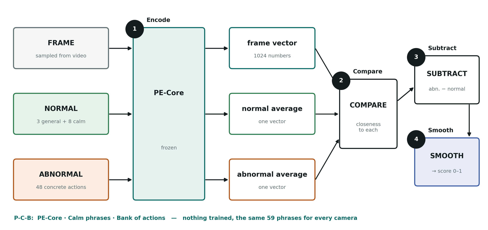

# DA-ZVAD Handbook, November 2026 edition (final)

*Plain language, built to be learned, remembered, taught and defended.
First written 6 November 2026 after the freeze; updated 7 November 2026 with the
sealed UBnormal result, the two papers, the IEEE report and the final deck. The older,
longer handbook (`00_HANDBOOK.md`) stays as the detailed reference for Phases 1–3.*

---

## How to use this

| If you have | Read |
|---|---|
| 5 minutes | Part 0 (one page) and the memory card at the end of it |
| 30 minutes | Parts 0, 1, 4 and 6 |
| 2 hours | Everything, then the self-quiz in Part 9 |
| The night before a viva or interview | Part 0, Part 6, and say Part 7 out loud |

Each part builds on the one before. Numbers marked *illustrative* are made up to
show how something works; every other number is a real, measured result.

---

# Part 0 — The whole project on one page

**What it does.** Watches CCTV video and gives every frame an anomaly score: how
likely it is that something unusual is happening, like a fight, a car on a footpath,
or someone collapsing.

**What makes it different.** It is **training-free**. Nothing is trained, ever. It uses
a frozen, ready-made model that understands pictures and words, and compares each
frame with two lists of sentences: one describing normal scenes and one describing
anomalies.

**The journey in five lines.**
1. We first gave the detector one sentence about each camera. It helped on campus video (0.751).
2. On XD-Violence it failed badly (0.624 → 0.417), because the sentence was written from
   frames that already showed the violence.
3. So we stopped relying on that sentence and changed *how the detector describes normal and abnormal*.
4. The final model: **PE-Core + calm phrases + a frozen phrase bank**, with no sentence for
   each video. XD went from 41.7 to 72.2.
5. We **froze** it and tested it **once** on UBnormal, a dataset it had never seen: **0.747**,
   and all three predictions written beforehand came true.

**Final scores** (AUROC; AP for XD):

| ShanghaiTech | UCF-Crime | XD-Violence | NWPU Campus | **UBnormal (sealed test)** |
|---|---|---|---|---|
| 78.3 | 85.6 | 72.2 | 63.9 | **74.7** |

**Status.** The first four are *exploratory*, because the model was chosen on those datasets.
The UBnormal number is the honest one: the model was frozen before any UBnormal file was
downloaded, and it was scored once. The work is written up as two papers and one IEEE report
(Part 3.7).

### The memory card

> **Three ingredients: P-C-B.** **P**E-Core (the encoder), **C**alm normal phrases, **B**ank of concrete actions.
> Think of a **PCB**, a circuit board: three parts, no moving parts, nothing trained.
>
> **Three results:** XD 41.7 → 72.2; no worse than the old model anywhere; **0.747 on unseen
> UBnormal, +0.096 over the same encoder alone, all three predictions held.**
>
> **Three limits:** the development numbers were chosen on those datasets; an LLM wrote the bank
> knowing their anomaly types; one frame at a time, so motion and small objects are hard.
> (And UBnormal is computer-generated, not real footage.)
>
> **One sentence:** *"A frozen model compares each frame with calm descriptions of normal scenes and
> concrete descriptions of anomalies — no training, the same setup for every camera."*

---

# Part 1 — The problem, in everyday words

## 1.1 What is a video anomaly?

Anything unusual for that place: a fight, a theft, a fire, a car accident, a bicycle
racing through pedestrians, someone falling down. Anomalies are **rare**. A camera can
run for days with nothing happening, which is exactly why nobody can watch it all.

## 1.2 Why it is hard

**Normal depends on the place.**
- A car on a road is normal; a car on a campus footpath is an anomaly.
- Running on a sports track is normal; running through a train station may not be.

The picture can look almost the same while the right answer flips. This has a name
in the research your guides gave you: **concept shift**. The meaning changes, not the
appearance. Most domain-adaptation methods deal with the opposite case, where
appearance changes but meaning stays the same (a stop sign in fog or sunshine).

## 1.3 Why "training-free" matters

The usual approach is to collect hours of normal video from one camera and train a
model on it. Move the camera, and you start again: collect, label, retrain, for every
site. A training-free detector skips all of that. You plug it in, and it works from
day one. The price is accuracy: it will rarely beat a model trained on that exact camera.

---

# Part 2 — The tools, explained simply

## 2.1 Embeddings: turning things into lists of numbers

A computer can't compare a picture with a sentence directly. So both are turned into
a long list of numbers (about a thousand), called an **embedding** or **vector**. Things
that mean similar things get similar lists.

**Analogy:** every picture and every sentence gets a pin on a huge map. A photo of a
fight and the sentence "two people punching each other" land close together. The
sentence "an empty street" lands far away.

## 2.2 The encoder: the machine that makes the lists

The **encoder** is the model that turns pictures and sentences into vectors. It was trained
once, by its makers, on hundreds of millions of image-caption pairs. We never train it
further, which is why it is called **frozen**.

| | Encoder | Notes |
|---|---|---|
| Earlier phases | CLIP ViT-L | The classic picture-and-words model |
| Final model | **PE-Core** (Meta, 2025) | Newer, used by NOVA and Flashback too |

## 2.3 Similarity: how close two pins are

**Cosine similarity** measures how closely two vectors point in the same direction. It is high when a
frame and a sentence match, and low when they don't.

## 2.4 The anomaly score: one subtraction

For each frame:

```
score = closeness to the ABNORMAL sentences − closeness to the NORMAL sentences
```

- Each list of sentences is averaged into one vector first, called a **prototype**.
- The difference is squashed into the range 0 to 1 (a sigmoid, after multiplying by 100).
- Scores are smoothed over a few neighbouring frames, so a single odd frame doesn't cause an alarm.

*Illustrative example:* frame-to-normal similarity 0.21, frame-to-abnormal similarity 0.24.
Difference +0.03, times 100 = 3, sigmoid(3) ≈ 0.95, so the frame looks anomalous.

## 2.5 How we measure success

**AUROC** (used for ShanghaiTech, UCF-Crime and NWPU Campus):
> Pick one anomalous frame and one normal frame at random. AUROC is the chance that the
> anomalous one got the higher score.
- 0.5 = a coin flip. 1.0 = perfect. We write it as 0–100 too (85.6 means 0.856).
- Scores **can't be compared across datasets**. 64 on NWPU and 86 on UCF don't mean the model is
  "worse" on NWPU. Each dataset has its own difficulty.

**AP, average precision** (used for XD-Violence, because its official benchmark uses it):
> Of the frames the detector flags, how many are truly anomalous, averaged over every
> possible alarm threshold.

## 2.6 Confidence intervals: is a difference real or luck?

A score from 290 videos could be a bit different with another 290. To check, we
**resample**: we redo the measurement 1,000 times on random re-draws of the video list.
This is called a **bootstrap**. The middle 95% of those results is the **95% confidence interval (CI)**.

- If the CI for "new minus old" is **entirely above zero**, the improvement is **significant**, very
  unlikely to be luck.
- If it **includes zero**, we say **"within noise"**.

## 2.7 Calibration vs re-ranking

Two ways a change can raise a score:
- **Calibration:** it moves whole videos up or down, so different cameras end up on the same scale.
  *"Scale, not sort."*
- **Re-ranking:** it puts the frames *inside* a video in a better order, so the anomaly stands out from
  its own surroundings.

Both count. Re-ranking is the stronger kind of evidence, because it shows the detector is
seeing the event itself. An audit we ran found most of the old sentence's gains were
calibration. The calm phrases' gains on ShanghaiTech and NWPU were mostly re-ranking.

---

# Part 3 — The journey, as a story

## 3.1 The first idea: tell it where it is (Phases 1–2)

*"Don't retrain the detector. Tell it, in English, where it is."* A sentence such as
"a university campus walkway with pedestrians" was added to the normal side.
- ShanghaiTech: 0.734 with one shared sentence, and **0.751** with a sentence for each camera written by LLaVA, a captioning model.
- A *wrong* sentence cost about 10 points. So the sentence really carried information about the scene.

## 3.2 Crime video (Phase 3)

- UCF-Crime: **0.824** with a LLaVA sentence for each video.
- **The audit:** about 82–87% of the gain was calibration. The sentence mainly put videos on one scale.

## 3.3 The failure: XD-Violence

- No sentence: **0.624** AP. With the LLaVA sentence: **0.417**.
- **Why:** LLaVA described the first 3 frames of each video. In **127 of the 500 violent videos**, the violence
  had already begun in those frames. So the sentence called the violence normal, and the detector ignored it.
- **The lesson:** a fix must not depend on what the first frames happen to show.

## 3.4 Reading the papers (November)

We read 15 recent papers. Three lessons:
1. **NOVA:** the normal side must *never* contain look-alike actions. Our earlier "near-miss" list did
   the opposite, adding "hugging" as normal next to fighting. **That was our mistake, and we disclosed it.**
2. **ASK-Hint:** concrete actions ("punching") work better than abstract labels ("fighting").
3. The top methods use a newer encoder (PE-Core), rich phrase lists, or heavy models.

## 3.5 The improvement round (5–6 November)

We tested one idea at a time, always with rules written first (Part 4.3). What we kept:
- **PE-Core** as the encoder, which alone wasn't enough;
- **C, the calm phrases**, which passed, and passed again with a second wording;
- **B, the phrase bank**, which passed.

What we dropped is listed in Part 5.4. Then we **froze** the model for a single test on unseen data.

## 3.6 The sealed test (6 November)

*"Like a sealed exam paper: study, lock your answers, then open the paper once."*
- The model's files were fixed by their fingerprints (hashes) and committed to Git **before** any
  UBnormal file was downloaded. Three predictions and the exact wording for each possible result
  were committed with them.
- UBnormal: 29 computer-generated scenes, 211 test videos, 92,640 frames. Its test anomalies
  (seizures, people lying down, car crashes, fire, smoke, jaywalking…) are deliberately different
  from its training anomalies.
- The test was run **once**. Result: **0.747**, +0.096 over plain PE-Core. All three predictions held.
  Full details in Part 5.7.

## 3.7 Writing it up (6–7 November)

Your guides asked for **two papers**, so the work is split in two:

| | Paper 1 | Paper 2 |
|---|---|---|
| Title (short) | Concept shift: what a scene description does, and where it fails | Calm words and concrete actions: a frozen text prior, verified by a sealed test |
| Model | CLIP ViT-L + a sentence per camera (LLaVA) | PE-Core + calm phrases + phrase bank |
| Main message | The sentence matters, but mostly calibrates, and it breaks on XD | One fixed list for every camera works better, and holds on unseen data |
| File | `docs/09_paper/paper1_concept_shift.tex` | `docs/09_paper/paper2_frozen_normality.tex` |

Plus: **one IEEE-format report** combining both, for college (`docs/09_paper/report_ieee_combined.tex`),
the final slides (`docs/06_presentations/DA-ZVAD_Final_Review.pptx`) and a plain-language speaking
script (`DA-ZVAD_Final_Presentation_Script.docx`).

**Two honesty points written into Paper 2** (know them; say them first):
1. The idea of calm, low-motion normal phrases **comes from NOVA**, and it is credited. Our phrases
   are our own, and we left out NOVA's visual anchor (it is taken from each test video's frames).
2. The UBnormal paper, which lists its test anomaly types, was read on **3 November**, before the
   phrase bank was written on **5 November**. No UBnormal video or label was seen before the test,
   but the overlap may owe something to that reading.

---

# Part 4 — The final model, step by step

## 4.1 The picture



The detailed version, with notation (bold, print-size, the one in Paper 2, the report and the
slides): `docs/09_paper/figures/fig_architecture_final.png`.
The earlier design (with the sentence and LLaVA) stays at `docs/09_paper/dazvad_architecture_detailed.png`
for reference.

In plain text:

```
 Frame (every 16th)  ─► PE-Core image encoder ─► frame vector v
 Normal:   3 general + 8 calm phrases ─► PE-Core text ─► average e⁺
 Abnormal: 48 concrete actions        ─► PE-Core text ─► average e⁻

 score = sim(v, e⁻) − sim(v, e⁺)
   ─► sigmoid(100 ×) ─► smooth over 5 frames ─► anomaly score (0 to 1)
```

**Memorise it as four verbs: Encode → Compare → Subtract → Smooth.**

*One exception to know:* ShanghaiTech follows its own benchmark protocol, using every 2nd frame,
smoothing over 31 frames, and rescaling scores within each clip. The other datasets, and the sealed test,
use every 16th frame, smoothing over 5, and raw scores.

## 4.2 The three ingredients (P-C-B)

### P — PE-Core, the encoder
- Replaces CLIP ViT-L and does the same job.
- **Alone it is not the fix.** With no other change it was better only on UCF-Crime (84.7 vs 75.6), and much
  worse on XD (49.4 vs 62.4). The gains came from the text.

### C — Calm normal phrases
Eight fixed phrases added to the normal side:

| Quiet places | Calm people |
|---|---|
| an empty walkway | a person standing still |
| an empty street | a person sitting quietly |
| an empty room | two people talking calmly |
| a quiet open area with nobody around | a person walking slowly |

- **Why it works:** normal should be described as still and calm, with nothing that looks like an anomaly.
  Then the normal and abnormal sides stay clearly apart.
- **Effect on PE-Core:** ShanghaiTech +9.1, XD +14.1, NWPU +5.1 (all significant); UCF −3.0 (within noise).
- **Was it luck?** We wrote a second, completely different set of eight calm phrases. It passed too.

### B — A bank of 48 concrete actions
- **12 types × 4 phrases:** fighting, weapon, theft, vandalism, road accident, fire or explosion, riot or
  arrest, abuse, falling, vehicle among pedestrians, sudden running, trespass.
- **Examples:** "two people punching each other", "a cyclist riding through a crowd of pedestrians", "a car on fire".
- It replaces the old three vague abnormal phrases, like "a dangerous or violent event".
- **Written once by an LLM, before any score existed, then frozen.** The same list is used for every dataset.
- **Effect on top of C:** XD +8.8 and UCF +3.9 (significant); ShanghaiTech +2.6 and NWPU −3.0 (within noise).

## 4.3 How we decided: the rule

Every idea had its rules **written and committed to Git before** any score existed. An idea was kept only if,
across the four datasets, it was:
1. **higher on more than half** of them,
2. **significantly better on at least two,**
3. **significantly worse on none.**

Every run also had to reproduce the old scores exactly before anything new was reported.
That catches bugs.

> **Why this matters in a viva:** it shows we didn't keep trying things until the numbers looked good.
> The rule decided, and the date in Git proves the rules came first.

---

# Part 5 — The results and how to read them

## 5.1 Old model to final model

| | ShanghaiTech | UCF-Crime | XD-Violence (AP) | NWPU Campus |
|---|---|---|---|---|
| Old: ViT-L + LLaVA sentence | 75.1 | 82.4 | **41.7** | 66.7 |
| Plain PE-Core | 66.6 | 84.7 | 49.4 | 61.7 |
| PE-Core + C | 75.7 | 81.7 | 63.5 | 66.9 |
| **Final: PE-Core + C + B** | **78.3** | **85.6** | **72.2** | **63.9** |

- Against the old model, on the same videos: **no worse on any dataset, significantly better on XD.**
- NWPU is 3 points lower than with C alone, within noise. Say this before anyone asks.

## 5.2 Against published methods

Every figure below was checked in its paper's PDF (`docs/07_reference_papers/PROVENANCE.md`).

| Dataset | Ours | Below us | Above us |
|---|---|---|---|
| UCF-Crime | 85.6 | Frozen VLM 85.3, PANDA 84.9, VADTree 84.7, AnyAnomaly 80.7, LAVAD 80.3 | Flashback-PE 87.3, ASK-Hint 89.8, NOVA 89.9 |
| XD-Violence (AP) | 72.2 | VERA 70.5, PANDA 70.2, Frozen VLM 69.0, VADTree 68.9, LAVAD 62.0 | Flashback-PE 75.1, NOVA 84.8 |
| ShanghaiTech | 78.3 | MPN 73.8, Liu et al. 72.8 (trained) | FPDM 78.6, AnyAnomaly 79.7, MULDE 81.3, AnomalyRuler 85.2 |
| NWPU Campus | 63.9 | HF2-VAD 63.7, MNAD 62.5, MemAE 61.9 (trained) | MPN 64.4, AMMC-Net 64.5, Cao et al. 65.8 and 68.2 (trained) |

**The rule for talking about this table:** gaps of 1–2 points may be noise. Say "above" or "below",
never "beats" or "state of the art".

## 5.3 Why these numbers are good

1. **No training at all.** No labels, no fine-tuning, no captioning model at run time.
2. **One setup for crime and campus.** NOVA, Flashback and ASK-Hint report only on crime datasets.
3. **Campus is hard for everyone.** NWPU's own authors reach 68.2 *with* training. Trained one-class methods
   score about 62–66. We reach 63.9 with none. On ShanghaiTech we're level with trained FPDM (78.6).
4. **The numbers can be trusted:** rules first, confidence intervals, failures reported, and a
   sealed test on unseen data that came out as predicted (0.747).

## 5.4 What we tried and dropped (one line each)

| Idea | Why it was dropped |
|---|---|
| "Normal scene / Anomalous scene" labels | Gained on three datasets, but significantly worse on NWPU |
| Both encoders together | Only XD improved, at double the cost |
| Scoring by anomaly type (NOVA) | XD rose to 76.9, but ShanghaiTech fell 8 points |
| Different templates per side (Flashback) | Significantly worse on NWPU |
| Phrases chosen by scene | No gain, though it recognised scenes well (11 of 12 ShanghaiTech cameras picked "campus walkway") |
| Camera memory | Significantly worse on ShanghaiTech and XD |

## 5.5 Why some methods score higher, and why we don't copy them

| Method | What gives it the edge | Why we don't copy it |
|---|---|---|
| NOVA | An LLM writes 20 normal + 20 abnormal phrases per type, with guidance for each dataset | Tailored to crime datasets; its scoring cost us 8 points on campus |
| Flashback | A memory of 1 million generated captions (GPT-4o, 76 hours, $181), and a video encoder | Expensive to build; needs a different encoder |
| ASK-Hint | A large video-language model | Heavy; it chose its prompt count from its own results table |
| Frozen VLM | A large model asked about every frame | Heavy at run time |

**What limits our model** (memorise these three):
1. **One frame at a time:** running looks like walking in a single frame.
2. **The whole frame at once:** a small bicycle in a crowd barely changes the frame's vector.
3. **Tailoring has a price:** what helps crime video can hurt campus video.

## 5.6 Honest limits

- **The four development numbers are exploratory:** the model was chosen on those datasets.
  Only the UBnormal number is a true test.
- **The bank isn't independent:** the LLM that wrote it knew the development datasets' anomaly types,
  and the UBnormal paper (with its anomaly list) had been read before the bank was written.
- **NWPU dropped a little** with the bank (66.9 → 63.9, within noise).
- **XD is still behind the leaders** (72.2 against Flashback-PE's 75.1 and NOVA's 84.8).
- **One sealed test, and it is synthetic:** UBnormal is computer-generated, so real footage from new
  sites is still untested.
- **The calm-phrase idea is NOVA's,** credited in the paper; what is ours is using it with a fixed
  bank, on every camera, and testing it this way.

## 5.7 The sealed test, and why it matters

On 6 November 2026 the model was **frozen**: every setting was fixed and committed (Git commit `3792b86`)
before any UBnormal data was downloaded. The test code, with safety checks ("gates") that refuse to
run if any frozen file changed, was committed next (`5c52d41`). Then UBnormal was downloaded and
scored **once**. The script refuses a second run.

> *"We chose the model on four datasets, then froze it and tested it once on a fifth it had never
> seen. So the final number shows how it does on new data, not how well we tuned it."*

**Before the run, all gates passed:** the seven frozen files matched their fingerprints, the model
reproduced its development scores exactly, and all 211 test videos were present.

**The result** (micro AUROC over all 92,640 frames; 95% interval from 1,000 re-draws of the videos):

| Model | Micro AUROC | 95% interval | Macro AUROC |
|---|---|---|---|
| **Final: PE-Core + calm phrases + bank** | **0.747** | [0.704, 0.789] | 0.906 |
| PE-Core + calm phrases | 0.687 | [0.634, 0.741] | 0.896 |
| Plain PE-Core | 0.651 | [0.599, 0.708] | 0.858 |
| Plain CLIP ViT-L (the old encoder) | 0.586 | [0.522, 0.644] | 0.813 |

- *Micro* = all frames from all videos ranked together (the official measure). *Macro* = AUROC inside
  each video, then averaged.
- **Calm phrases add +0.036**, the bank adds **+0.060** more, together **+0.096 [+0.051, +0.142]** over
  plain PE-Core. Every effect has the same sign as in development.

**The three predictions, written before any UBnormal data existed:**

| Prediction | Measured | Result |
|---|---|---|
| U1: the interval lies above 0.5 (chance) | [0.704, 0.789] | holds |
| U2: final model beats plain PE-Core | +0.096 | holds |
| U3: the score falls between 0.60 and 0.75 | 0.747 | holds, by 0.003 |

*U3 nearly failed by being too good. That shows the range was set cautiously, not tuned.*

**What we are allowed to say** (the wording was fixed in advance): the model *"detects anomalies on
an unseen dataset, without training"*, and *"the calm phrases and bank carried over to unseen data"*.
Against plain CLIP the rule only allows *"no worse"*, even though the gap is +0.161, because the rule
needs two benchmarks and a single test has one. We keep to the rule as written.

**Looked at afterwards (not pre-registered, so it describes rather than tests):**
- Better than plain PE-Core in **20 of 29 scenes**; median scene score 0.788 → 0.823; never below chance
  in any scene (lowest 0.514).
- Each bank type alone beats chance. **Falling** is strongest (0.766), close to UBnormal's
  "having a seizure" and "laying down". **Vehicle among pedestrians** is weakest (0.542).

**Against published UBnormal results** (all checked in their papers; all use UBnormal's own
training data, ours used none):

| Method | Micro AUROC |
|---|---|
| Georgescu et al. (the benchmark's authors) | 59.3 |
| FPDM | 62.7 |
| OVVAD | 62.94 |
| Bertasius et al., fine-tuned | 68.5 |
| STG-NF | 71.8 |
| AnomalyRuler | 71.9 |
| **Ours (frozen, no UBnormal data)** | **74.7** |

> **Say "above", not "better":** STG-NF and AnomalyRuler are inside our interval (70.4–78.9).

---

# Part 6 — Defending it: 26 likely questions

**1. What does your system do, in one line?**
It gives every CCTV frame an anomaly score by comparing it with calm descriptions of normal scenes and
concrete descriptions of anomalies, using a frozen model and no training.

**2. Why training-free? Isn't training always better?**
Training usually scores higher on the camera it was trained for, but needs labelled video from every new
site. Training-free works from day one anywhere. I measure how close it gets, and on campus data it's
inside the range of trained methods.

**3. What is PE-Core?**
Meta's 2025 Perception Encoder. It turns images and text into comparable vectors, like CLIP but newer.
On its own it wasn't the improvement. The text changes were.

**4. Why do calm phrases help?**
Without them, the normal side is vague, and some normal phrases sit close to anomalies. Calm, still
scenes keep the two sides far apart, so a frame showing action moves clearly towards the abnormal side.
It's NOVA's rule: never put look-alike actions on the normal side.

**5. How do you know the calm phrases weren't just lucky wording?**
I wrote a second, completely different set of eight calm phrases and tested it under the same rule. It
passed too.

**6. Who wrote the phrase bank? Did an AI write it?**
Yes, an LLM wrote it once, before it was scored, and then it was frozen. NOVA and Flashback also use
LLM-written text. I state openly that the LLM knew these datasets' anomaly types. That's why the sealed
test on an unseen dataset matters.

**7. Didn't you tune on the test data?**
The four datasets shaped my choices, so I call those results exploratory. To deal with that, I froze the
model and tested it once on UBnormal, which played no part in any decision. It scored 0.747, and all
three predictions I had written down beforehand held.

**8. Why is NWPU only 63.9?**
NWPU is hard for everyone. Its own authors reach 68.2 with training, and trained one-class methods score
62–66. Its anomalies are often small or depend on the scene, which a whole-frame model struggles with.

**9. NOVA gets 89.9 on UCF. Why not just use NOVA?**
NOVA writes 20 + 20 phrases for each anomaly type with guidance for each dataset, and only tests on crime
datasets. When I tried its scoring, XD rose but ShanghaiTech fell 8 points. I want one setup that works
on any camera.

**10. What is AUROC?**
The chance that a random anomalous frame scores higher than a random normal frame. 0.5 is a coin flip,
1.0 is perfect.

**11. Why AP for XD-Violence?**
Because XD's official benchmark uses it, so my numbers are comparable with published ones.

**12. What does "significant" mean here?**
I redo the measurement on 1,000 random re-draws of the videos. If the middle 95% of "new minus old" is
above zero, the gain is very unlikely to be luck.

**13. What failed?**
Six ideas: keyword labels, two encoders, scoring by type, different templates, scene-chosen phrases, and
camera memory. All are reported with their reasons.

**14. Why did the scene idea fail if scenes were recognised correctly?**
Recognition worked: 11 of 12 ShanghaiTech cameras picked "campus walkway". But the scene's shorter phrase
list scored the same as the whole bank, so the extra step added nothing to the score.

**15. What happened to your original sentence idea?**
It helped on campus video, but it broke XD-Violence because the sentence was written from frames already
showing violence. Better phrases for normal and abnormal turned out to matter more than a sentence for
each video.

**16. What is concept shift?**
When the same picture means something different in a different place, like a car on a road and a car on a
footpath. Anomaly detection is full of it, while most domain adaptation deals with appearance changes instead.

**17. Is this novel?**
The individual parts come from earlier work, and I credit them (calm phrases from NOVA, concrete actions
from ASK-Hint). What's new: measuring that a scene description mostly *calibrates* cameras; showing that
where text enters the prompts can *reverse* its effect; and testing one fixed, training-free setup on
crime and campus data with rules written in advance, then on a benchmark sealed before testing. I know
of no other training-free paper that reports a sealed test.

**18. What would you do with more time?**
Score parts of the frame, for small objects. Try a video encoder, for motion. Test on more unseen datasets.

**19. Would it work in real life?**
It needs no setup data and runs one frame through one encoder, so it's light. On 29 scenes it had never
seen it scored 0.747 with no setup. Its weak spots are small objects and motion, and it has not yet been
tested on real footage from a brand-new site; UBnormal is computer-generated.

**20. What is the one result you are proudest of?**
The sealed test: I froze the model, then scored a dataset I had never touched exactly once, and it came
out as predicted (0.747). Close second: XD-Violence going from 41.7 to 72.2, decided by a rule written
before any number.

**21. What does 0.747 mean in plain words?**
Pick one unusual frame and one normal frame from UBnormal at random. About 75 times in 100, the model
gives the unusual one the higher score. Guessing would be 50.

**22. Did you look at UBnormal before testing?**
No video or label. But I did read the UBnormal paper on 3 November, to plan the test, and that paper lists
its anomaly types. The phrase bank was written on 5 November. I state this openly in the paper.

**23. Your result is above every published UBnormal number. So you beat them?**
"Above", not "better". STG-NF (71.8) and AnomalyRuler (71.9) lie inside my interval (70.4–78.9). Also, all
of them trained on UBnormal's own data, and mine used none, so they are not equally informed.

**24. Why do you only say "no worse" than plain CLIP when the gap is +0.161?**
Because the rule I wrote before the test says "better" needs significant gains on two benchmarks, and a
single test has one. I apply the rule as written, even when it costs me a stronger sentence.

**25. Why two papers? How are they different?**
Paper 1 is the diagnosis: what a scene sentence does with CLIP, why it mostly calibrates, and why it broke
on XD. Paper 2 is the fix: one fixed list on PE-Core, developed under rules and verified on the sealed
test. Paper 2 cites Paper 1 and does not repeat it.

**26. Did you use AI tools?**
Yes: an AI assistant for coding help and drafting text, declared in both papers, and an LLM wrote the
phrase bank, which the paper says. Every number comes from runs logged in Git with a manifest, and I
can walk through any of them.

---

# Part 7 — Teaching it to anyone

## 7.1 The 30-second version (anyone)

*"CCTV cameras record far more than anyone can watch. My system scores each moment for how unusual it
looks. It uses a ready-made AI model that understands pictures and words, and compares each frame with
calm descriptions of normal scenes and concrete descriptions of trouble, like a fight or a fire. Nothing
is trained, so it can be used on a new camera straight away. I locked it and tested it once on a dataset
it had never seen, and it worked as I had predicted."*

## 7.2 The 2-minute version (a technical interviewer)

1. **Problem:** video anomaly detection without training, where normal depends on the place (concept shift).
2. **Method:** a frozen PE-Core encoder. Score = similarity to an abnormal prototype minus similarity to a
   normal prototype, then sigmoid and smoothing.
3. **Key idea:** the text. The normal side is calm, with no look-alike actions, and the abnormal side is 48
   concrete actions written once and frozen.
4. **Story:** a per-camera sentence broke XD because it was written from frames already showing
   violence. The new text fixed it: 41.7 → 72.2.
5. **Rigour:** one idea at a time, rules committed first, confidence intervals, six failures reported.
6. **Proof:** frozen, then scored once on unseen UBnormal: 0.747, +0.096 over the same encoder alone,
   all three pre-registered predictions held.

## 7.3 The whiteboard version

### Drawing the architecture in 60 seconds

Draw from left to right, and say each line as you draw it:

1. **Three boxes, stacked on the left:** FRAME, NORMAL, ABNORMAL. *"Three inputs: the video frame, calm
   descriptions of normal, and 48 concrete descriptions of anomalies."*
2. **One tall box in the middle, labelled PE-Core with a snowflake.** Draw three arrows into it.
   *"Step 1, encode: one frozen model turns all three into vectors. Nothing is trained."*
3. **Three boxes on its right:** frame vector, normal average, abnormal average. *"Each list of phrases is
   averaged into one vector."*
4. **A COMPARE box** with all three arrows going in. *"Step 2, compare: how close is the frame to each side?"*
5. **SUBTRACT, then SMOOTH**, stacked on the far right. *"Step 3: abnormal closeness minus normal
   closeness. Step 4: smooth over a few frames, and that's the anomaly score."*
6. **Write P-C-B underneath.** *"PE-Core, Calm phrases, Bank of actions."*

**If asked for detail**, add λ = 100 and the sigmoid next to SUBTRACT, "5 frames" next to SMOOTH, and
"1024 numbers" next to the frame vector. The detailed figure has everything else.

### The quick sketch

If you only have a corner of the board, draw this, top to bottom, saying the four verbs aloud:

```
   FRAME ──encode──► vector
                        │  compare with
         ┌──────────────┴──────────────┐
   NORMAL (calm)                  ABNORMAL (48 actions)
         └──────────────┬──────────────┘
                     subtract
                        │
                      smooth
                        │
                  ANOMALY SCORE
```

## 7.4 An analogy for non-technical people

*"Imagine a guard with two photo albums: one of calm, ordinary scenes and one of trouble, like fights,
fires and accidents. For every moment of video, the guard asks which album it looks more like. My system
does that with an AI model instead of a guard, and nobody has to train it first."*

---

# Part 8 — Glossary in plain words

| Term | Plain meaning |
|---|---|
| Anomaly | Something unusual for that place |
| Training-free / zero-shot | Used as is, with nothing learned from the target data |
| Frozen | The model's internals are never changed |
| Encoder | The model that turns pictures and text into vectors |
| Embedding / vector | A list of numbers that stands for a picture or sentence |
| Cosine similarity | How closely two vectors point the same way |
| Prototype | The average of a list of phrase vectors |
| Margin | Abnormal similarity minus normal similarity |
| Sigmoid | Squashes any number into the range 0–1 |
| AUROC | Chance an anomalous frame outscores a normal one |
| AP | How precise the alarms are, averaged over thresholds |
| Bootstrap | Redoing a measurement on many random re-draws |
| 95% CI | The range the true difference very likely lies in |
| Significant | CI entirely above (or below) zero |
| Calibration | Moving whole videos onto one scale |
| Re-ranking | Ordering frames better within a video |
| Concept shift | The same picture means something different elsewhere |
| Pre-registration | Writing the rules and predictions before seeing results |
| Sealed test | One test on data never used for any decision |
| UBnormal | The sealed-test dataset: 29 computer-generated scenes, never used for any choice |
| Micro / macro AUROC | Micro: all frames of all videos ranked together. Macro: inside each video, then averaged |
| Gates | Safety checks that stop the test if any frozen file changed or old scores don't reproduce |
| Post hoc | Looked at after the result; describes, does not test |
| PE-Core | Meta's 2025 encoder used in the final model |
| C | The eight calm normal phrases |
| B | The 48-phrase bank of concrete actions |

---

# Part 9 — Self-quiz

Cover the answers and say each one out loud.

| # | Question | Answer |
|---|---|---|
| 1 | What are the three ingredients? | PE-Core, calm phrases, phrase bank (P-C-B) |
| 2 | The four verbs of the pipeline? | Encode, compare, subtract, smooth |
| 3 | XD before and after? | 41.7 → 72.2 |
| 4 | Final scores on the four datasets? | 78.3, 85.6, 72.2, 63.9 |
| 5 | Why did the LLaVA sentence break XD? | It was written from first frames that already showed violence (127 of 500 videos) |
| 6 | NOVA's rule for the normal side? | Never include look-alike actions |
| 7 | How was luck in the calm phrases ruled out? | A second, different wording also passed |
| 8 | The three parts of the keep rule? | Better on more than half, significant on at least 2, significantly worse on none |
| 9 | Name three dropped ideas | Any three: labels, two encoders, scoring by type, templates, scene choice, camera memory |
| 10 | Why is NWPU hard? | Small and scene-dependent anomalies; trained methods only reach 62–68 |
| 11 | Why not copy NOVA? | Tailored to crime datasets; its scoring cost 8 points on ShanghaiTech |
| 12 | What is the sealed test, and its result? | One frozen run on unseen UBnormal: 0.747, +0.096 over plain PE-Core, all 3 predictions held |
| 13 | AUROC in one sentence? | Chance a random anomalous frame outscores a random normal one |
| 14 | Calibration or re-ranking: which is stronger evidence? | Re-ranking; it shows the event itself is seen |
| 15 | Three limits? | Development numbers chosen on those datasets; the bank isn't independent; one frame at a time |
| 16 | Why "above", not "better", on UBnormal? | STG-NF 71.8 and AnomalyRuler 71.9 are inside our interval |
| 17 | Which idea is NOVA's, and is it credited? | Calm, low-motion normal phrases; yes |
| 18 | What do Paper 1 and Paper 2 each say? | 1: the sentence mostly calibrates and breaks on XD. 2: one fixed list works better and holds on unseen data |

---

## Where things live

| What | Where |
|---|---|
| Final model's rules, freeze and sealed result | `docs/10_phase3/PREREG_sealed_ubnormal.md` (dated addenda) |
| Sealed test code and result | `notebooks/sealed_ubnormal.py`, `results/runs/analysis/sealed_ubnormal.json` |
| The two papers and the IEEE report | `docs/09_paper/paper1_concept_shift.tex`, `paper2_frozen_normality.tex`, `report_ieee_combined.tex` |
| Calm phrases (C) and the bank (B) in code | `da_zvad/prompts/fixes.py` (`CALM_NORMAL`), `da_zvad/prompts/ideas.py` (`BANK`) |
| The improvement round, step by step | `docs/10_phase3/PREREG_ideas.md` |
| The fixes run that found C | `docs/10_phase3/PREREG_fixes.md` |
| Phrases (C, the second wording, B) | `da_zvad/prompts/fixes.py`, `da_zvad/prompts/ideas.py` |
| Experiment code | `notebooks/ideas_sweep.py`, `notebooks/fixes_sweep.py` |
| Results | `results/runs/analysis/ideas_step*`, `fixes_*` |
| Published numbers, checked | `docs/07_reference_papers/PROVENANCE.md` |
| Presentation and script | `docs/06_presentations/DA-ZVAD_Final_Review.pptx`, `DA-ZVAD_Final_Presentation_Script.docx` |
| Detailed earlier handbook | `docs/08_understanding/00_HANDBOOK.md` |
