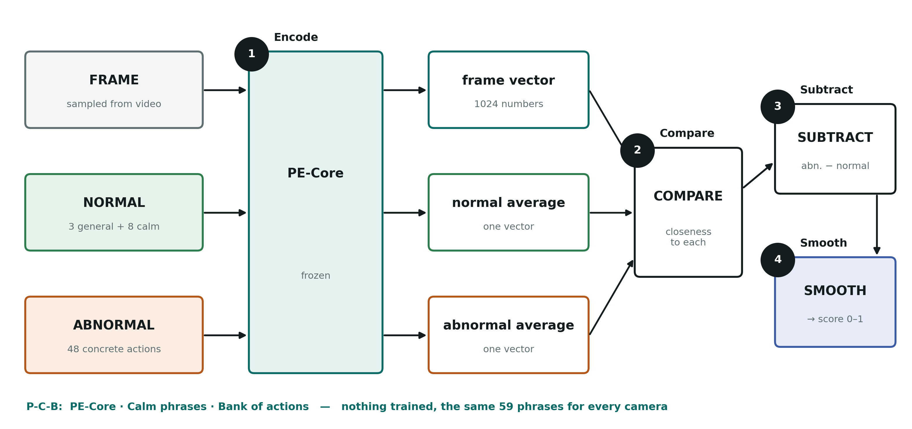

# Guide Meeting Brief: what we built after Phase 3

> For the meeting on **7 November 2026**. Read it once tonight and once before you go in.
> Everything here is a real, measured result unless it says *example*.

---

## 1. Say this first (60 seconds)

- **What broke:** "Our Phase 3 model added one sentence about each camera, written by LLaVA. On XD-Violence it
  failed badly: 0.624 without the sentence, 0.417 with it."
- **Why:** "The sentence was written from each video's first frames. In 127 of 500 violent videos the violence
  had already started there, so the sentence described the violence as normal."
- **What I built instead:** "I removed the sentence. The new model uses a stronger frozen encoder, PE-Core,
  plus two fixed lists of text: calm descriptions of normal scenes, and 48 concrete descriptions of anomalous
  actions. It is still completely training-free."
- **Result:** "XD went from 0.417 to 0.722. The new model is no worse than the old one on any dataset, and it
  needs no captioning model."
- **Status:** "Every idea was tested under rules I wrote before seeing the result. The model is now frozen,
  and I'll test it once on a new dataset, UBnormal."

---

## 2. What changed since Phase 3

| | Phase 3 (CLIP) | Now (Phase 4) |
|---|---|---|
| Image encoder | CLIP ViT-L/14 | **PE-Core** (Meta, 2025) |
| Normal text | 3 general phrases **+ one sentence per camera** | 3 general phrases **+ 8 calm phrases** |
| Abnormal text | 3 vague phrases ("a dangerous or violent event") | **48 concrete actions** in 12 types |
| Captioning model | LLaVA writes each camera's sentence | **None** |
| Same text for every camera? | No, a sentence each | **Yes, the same 59 phrases everywhere** |
| Training | None | None |
| Datasets tested | ShanghaiTech, Avenue, UCF-Crime | ShanghaiTech, UCF-Crime, **XD-Violence**, **NWPU Campus** |

**What did not change:** every model stays frozen, the score is still "how close the frame is to abnormal
text minus how close it is to normal text", and there is still smoothing over time.

---

## 3. Why we changed: the XD-Violence failure

1. **Two new benchmarks.** XD-Violence has films, sports, games, news and CCTV, and is scored by average
   precision (AP), its official measure. NWPU Campus has 43 campus scenes.
2. **The sentence broke XD:** AP fell from 0.624 to 0.417.
3. **The cause was found:** LLaVA described the first 3 frames of each video, and in 127 of 500 violent
   videos those frames already showed the violence.
4. **It was checked:** dropping the sentence on just those 127 videos recovers 66% of the loss.
5. **The lesson:** a good fix must not depend on what a camera's first frames happen to show.

> **One-liner:** *"The sentence was meant to describe normal, but sometimes it described the anomaly itself."*

---

## 4. The idea in one sentence

> **Describe "normal" calmly and "abnormal" concretely, with one fixed set of phrases, and let a frozen
> model decide which description each frame is closer to.**

**Analogy for the guide:** *"A guard has two photo albums: one of calm, ordinary scenes and one of
specific trouble, like fights, fires and accidents. For every moment of video, the guard asks which album it
looks more like. My system does that with a frozen model, and nobody trains it."*

---

## 5. The architecture, and why each part is there

The full paper figure is `docs/09_paper/dazvad_architecture_v3_paper.png`, in the same style as the Phase 3
CLIP figure.

**The four steps: Encode → Compare → Subtract → Smooth.**

| Step | What happens | Why it is done this way |
|---|---|---|
| **1. Encode** | PE-Core turns each frame, and each of the 59 phrases, into a list of 1,024 numbers | One frozen model for both pictures and text, so they can be compared directly |
| **2. Compare** | Each side's phrases are averaged into one vector, and the frame is compared with both | Averaging gives one stable "normal" and one stable "abnormal" description |
| **3. Subtract** | Score = closeness to abnormal − closeness to normal, then a sigmoid to get 0–1 | The same rule as Phase 3, so the comparison with Phase 3 is fair |
| **4. Smooth** | The score is averaged over 5 sampled frames, about 3 seconds | One odd frame should not raise an alarm |

### Why each ingredient (the P-C-B memory aid)

**P: PE-Core, a stronger frozen encoder.**
- It is newer than CLIP and is used by the strongest recent methods (NOVA, Flashback).
- Be honest: on its own it was not the improvement. With no text changes it was better only on UCF-Crime
  (0.847 vs 0.756) and clearly worse on XD (0.494 vs 0.624). The gains came from the text.

**C: Calm normal phrases.** These are "an empty walkway", "an empty street", "an empty room", "a quiet open
area with nobody around", "a person standing still", "a person sitting quietly", "two people talking calmly"
and "a person walking slowly".
- **Why:** if "normal" is described as calm and still, it sits far from anything that involves action, so a
  frame showing action clearly moves towards "abnormal".
- **Where the idea came from:** the NOVA paper's rule says the normal side must **never** include actions that
  look like anomalies.
- **A mistake we found and admitted:** our earlier "near-miss" list did the opposite, adding "hugging" as
  normal next to fighting. Calm phrases correct that.
- **Was it luck?** I wrote a second, completely different set of eight calm phrases. It also passed the rule.

**B: A bank of 48 concrete actions.** These are 12 types of 4 phrases each: fighting, weapon, theft,
vandalism, road accident, fire or explosion, riot or arrest, abuse, falling, vehicle among pedestrians,
sudden running and trespass. Examples are "two people punching each other" and "a cyclist riding through a
crowd of pedestrians".
- **Why concrete:** the ASK-Hint paper showed that actions like "punching" work better than labels like
  "fighting".
- **How it was made:** an LLM wrote it once, before it was ever scored, and then it was frozen. The same list
  is used for every dataset. *Say this openly. It is why the sealed test matters.*

**Why no sentence and no LLaVA any more:** the sentence was where XD broke, and LLaVA is a large extra model.
Removing both made the system simpler and fixed the failure.

---

## 6. How I decided what to keep (the rigour)

This is the strongest point to make, given that the guide wants real research:

1. **Rules first:** before each idea, I wrote down what would count as success, plus my predictions.
2. **Committed before scoring:** the rules were saved in Git before any result existed, so the dates prove
   the order.
3. **Old scores reproduced:** every run first had to reproduce the old scores exactly. That catches bugs.
4. **The rule decides:** an idea was kept only if, across the four datasets, it was
   - better on more than half,
   - significantly better on at least two (95% confidence interval above zero),
   - significantly worse on none.

Confidence intervals come from re-drawing the test videos 1,000 times, the same method as in Phase 3.

---

## 7. Results: the progress

| Stage | ShanghaiTech | UCF-Crime | XD-Violence (AP) | NWPU Campus |
|---|---|---|---|---|
| Phase 1–2 · CLIP, no sentence | 0.707 | 0.756 | 0.624 | 0.659 |
| Phase 2 · one shared sentence | 0.734 | 0.813 | 0.582 | 0.648 |
| Phase 3 · LLaVA sentence per camera/video | 0.751 | 0.824 | **0.417** | 0.667 |
| Phase 4 · PE-Core + calm phrases | 0.757 | 0.817 | 0.635 | 0.669 |
| **Phase 4 · PE-Core + calm phrases + action bank (final)** | **0.783** | **0.856** | **0.722** | **0.639** |

**How to say it:**
- "Against the Phase 3 model on the same videos, the final model is **no worse on any dataset** and
  **significantly better on XD** (+0.305)."
- "On the other three it is higher by point estimate, but within noise."
- "NWPU is the honest exception: 0.639 is about 3 points below the calm phrases alone, also within noise."

*XD uses AP, its official measure; the rest use AUROC. AP and AUROC aren't on the same scale.*

---

## 8. Comparison with other published models

All figures were checked in each paper's PDF.

| Method | UCF-Crime (AUROC) | XD-Violence (AP) | ShanghaiTech | NWPU | Notes |
|---|---|---|---|---|---|
| NOVA | 89.86 | 84.82 | — | — | Training-free; 40 phrases per anomaly class, tailored to each dataset |
| ASK-Hint | 89.83 | — | — | — | Training-free; a large video-language model |
| Flashback-PE | 87.29 | 75.13 | — | — | Training-free; a memory of 1 million generated captions |
| **Ours (final)** | **85.6** | **72.2** | **78.3** | **63.9** | Training-free; one encoder and 59 fixed phrases |
| Frozen VLM | 85.32 | 68.98 | — | — | Training-free; a large model on every frame |
| AnyAnomaly | 80.7 | — | 79.7 | — | Training-free; a large vision-language model |
| LAVAD | 80.3 | 62.01 | — | — | Training-free; captioner + LLM |
| VERA | — | 70.54 | — | — | Learns on training data |
| FPDM / MULDE | 74.7 / 78.5 | — | 78.6 / 81.3 | — | **Trained** on the benchmark |
| MPN | — | — | 73.8 | 64.4 | **Trained** |
| Cao et al. (NWPU authors) | — | — | — | 68.2 | **Trained**, with scene information |

**How to read it:**
- **UCF-Crime and XD:** we are behind only the top few training-free methods (NOVA, ASK-Hint, Flashback).
- **ShanghaiTech:** we are level with methods that **train** on it (FPDM 78.6) and above MPN (73.8).
- **NWPU:** we are inside the range of trained methods (61.9–68.2), without training.
- **Caution:** a gap of 1–2 points is within our uncertainty, so never say "we beat X".

---

## 9. "Is this the best we can get?"

**Short answer:** *"It is the best I could reach with this approach, a frozen frame encoder plus text, and the
evidence suggests this approach is close to its limit."*

**The evidence:**
- After the bank, I tested six more ideas under the same rule: keyword labels, two encoders combined, scoring
  by anomaly type (NOVA's way), different templates per side (Flashback's way), choosing phrases by scene, and
  a memory of each camera's past. **None passed.**
- The text changes all ended up near the same scores. That says the remaining errors come from what the
  encoder can **see**, not from the wording.

**Why the top methods score higher:**

| They use | Why we don't |
|---|---|
| NOVA: 20 + 20 phrases for **each** anomaly class, with guidance written for each dataset | It is tailored to crime datasets, and is tested only on UCF and XD. When I tried its scoring, XD rose to 0.769 but **ShanghaiTech fell 8 points** |
| Flashback: a memory of 1 million generated captions, plus a video encoder | It is expensive to build (GPT-4o, 76 hours, $181) and needs a different encoder |
| ASK-Hint, Frozen VLM: a large video-language model on the video | It is heavy at run time, the opposite of our light design |

**What limits us** (say these three):
1. **One frame at a time:** running looks like walking in a single frame.
2. **The whole frame at once:** a small bicycle in a crowd barely changes the frame's numbers.
3. **Tailoring has a price:** what helps crime video can hurt campus video, and we use one setup for both.

**What could still raise it:** patch-level scoring for small objects, which needs new encoding (1–2 days), or
a video encoder for motion, which is future work. Training would help most, but it breaks the thesis premise.

---

## 10. Where is the "domain adaptation" now? (He may well ask this)

This is the most important question to answer well.

- **Phase 3 finding:** the per-camera sentence mostly **calibrated** cameras, putting them on one scale (82–87%
  of its gain), rather than re-defining normal. It also broke when the first frames contained the anomaly.
- **Phase 4 finding:** **one fixed description of normality works across very different domains**, crime and
  campus, with no per-camera step and no training. On the campus datasets, the gain from the calm phrases
  mostly **re-ranks frames inside each video**, the stronger kind of evidence, rather than just shifting levels.
- **The direct domain test:** in the scene-choice experiment, the system recognised each camera's scene well,
  and giving it the **wrong** scene hurt significantly on all four datasets. So scene knowledge is real. But the
  right scene added nothing beyond the full bank.
- **So the claim becomes:** *"A frozen model with a well-designed, domain-general description of normality
  handles concept shift across crime and campus cameras without any adaptation step. Per-camera text mainly
  calibrates, and it can fail."*
- **Ask him** whether to reframe the paper this way (section 13).

---

## 11. Honest limits (say them before he asks)

- **The results are exploratory.** The model was chosen on these four datasets, and many ideas were tried.
- **The bank isn't independent.** The LLM that wrote it knew these datasets' anomaly types.
- **NWPU dipped a little** when the bank was added (0.669 → 0.639, within noise).
- **XD is still behind the leaders:** 0.722 against Flashback's 0.751 and NOVA's 0.848.
- **The sealed test dataset, UBnormal, is computer-generated.**

---

## 12. Questions he may ask, and short answers

| Question | Answer |
|---|---|
| "Didn't you just tune on the test data?" | "These datasets guided my choices, so I call the results exploratory. That's why I froze the model and will test it once on UBnormal, which played no part in any decision." |
| "Who wrote the phrases?" | "I wrote the calm phrases following NOVA's rule. An LLM wrote the 48-action bank once, before scoring, and it was frozen. I disclose that, and the sealed test checks it." |
| "Why PE-Core?" | "It's the encoder the strongest recent methods use. Alone it wasn't enough; the text changes made the difference." |
| "Why not just use NOVA?" | "NOVA is tailored per crime dataset. Its scoring cost us 8 points on campus video. I want one setup for any camera." |
| "Is it novel?" | "The parts come from earlier work. What's new is one training-free setup tested on crime and campus benchmarks, with rules written in advance, confidence intervals, and the finding that a per-camera sentence mainly calibrates and can fail." |
| "Why is NWPU low?" | "It's hard for everyone. Its own authors reach 68.2 with training. We reach 63.9 with none." |
| "What failed?" | "Six ideas, all reported with their reasons. The most informative: scoring by type helps XD but hurts campus." |
| "What's next?" | "The sealed UBnormal test once, then patch scoring for the demo heatmap, then writing up." |

---

## 13. Decisions to ask him for

1. **Approve the sealed test** on UBnormal. The model is frozen and the rules are written.
2. **The paper's framing:** keep "adaptation through a sentence", with Phase 4 as a later chapter (as
   `main.tex` is now), or reframe around the final model and the "one description of normality" finding
   (section 10)?
3. **MSAD:** should we request access (it needs his signature) as a second unseen test?
4. **Venue:** a workshop or a mid-tier journal (PRL or Neurocomputing, as planned)?

---

## 14. Close with this

> *"The Phase 3 idea broke on XD for a reason I found. I replaced it with something simpler that needs no
> captioning model and is no worse anywhere, under rules I fixed in advance. The model is frozen, and one
> honest test on unseen data remains."*

**Where things are:** deck `docs/06_presentations/DA-ZVAD_Phase3_Phase4_Review.pptx` (slides 31–47 are Phase 4);
handbook `docs/08_understanding/01_HANDBOOK_NOV2026.md`; figure `docs/09_paper/dazvad_architecture_v3_paper.png`;
paper `docs/09_paper/main.tex` (Results 9–10).
